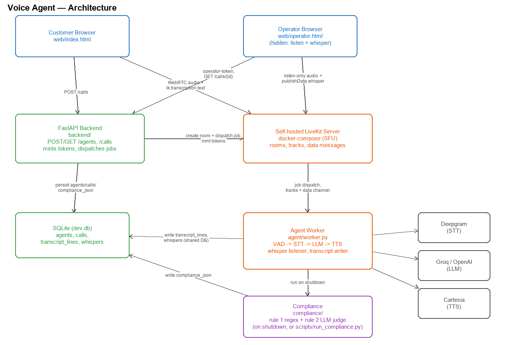

# Voice Agent on Self-Hosted LiveKit

Operator-guided voice AI agent built on a self-hosted LiveKit server: a customer talks to an
LLM-backed support agent over WebRTC, a hidden operator can listen in and whisper live guidance,
and every call is checked post-hoc against two compliance rules. See [AGENTS.md](AGENTS.md) for the
full phase plan this repo follows.

Status: Phases 0-10 complete, plus stretch goal S1 (operator take-over).

## Architecture



(Source: [`docs/architecture.excalidraw`](docs/architecture.excalidraw), editable at
[excalidraw.com](https://excalidraw.com).)

The backend (FastAPI) and the agent worker (`livekit-agents`) are two separate processes that both
dispatch/read through the self-hosted LiveKit server and share one SQLite database directly (the
worker does not go through the backend's HTTP API to persist transcript lines, whispers, or
compliance results -- it writes to the same DB file). The backend's job is creating calls, minting
short-lived tokens, and dispatching the worker to a room; the worker's job is the actual voice
pipeline (VAD -> STT -> LLM -> TTS) plus the whisper listener and the post-call compliance check.

## Setup (from scratch)

```bash
# 1. Install uv (if you don't have it)
curl -LsSf https://astral.sh/uv/install.sh | sh

# 2. Clone and enter the repo
git clone <this-repo-url>
cd voice_agent_livekit

# 3. Install Python dependencies (reads pyproject.toml + uv.lock; Python 3.11 per .python-version)
uv sync

# 4. Copy the env template and fill in your own provider keys
cp .env.example .env
# edit .env: DEEPGRAM_API_KEY, CARTESIA_API_KEY, and one of GROQ_API_KEY/OPENAI_API_KEY
# (LIVEKIT_* and DATABASE_URL already work out of the box for local, self-hosted use)

# 5. Start the self-hosted LiveKit server
docker compose up -d livekit

# 6. Seed the default "Acme Support" agent persona into SQLite
uv run python -m scripts.seed_agent

# 7. Run the backend (serves the API and the web client at the same origin)
uv run uvicorn backend.main:app --reload

# 8. In a second terminal, run the agent worker
uv run python -m agent.worker dev
```

Then open `http://localhost:8000/` in a browser for the customer side, pick the seeded agent, and
click Call. Open `http://localhost:8000/operator.html` in a second tab for the hidden operator
console (enter the call ID shown on the customer page to join).

Smoke-test the LiveKit server on its own, before touching the backend/worker, with:

```bash
uv run python scripts/smoke_join.py
```

Run the test suite (pure unit tests, no network/provider calls, no running server needed) with:

```bash
uv run pytest
```

## Ports & config

| Port             | Purpose                               | Why                                                                                                                                                                                                                                                                             |
| ---------------- | ------------------------------------- | ------------------------------------------------------------------------------------------------------------------------------------------------------------------------------------------------------------------------------------------------------------------------------- |
| 7880/TCP         | HTTP API and WebSocket signalling     | All client/server control traffic (room join, track negotiation) goes over this port.                                                                                                                                                                                           |
| 7881/TCP         | ICE/TCP fallback                      | Used when UDP is blocked by a restrictive network; media falls back to TCP at the cost of higher latency.                                                                                                                                                                       |
| 50000-50100/UDP  | Media (RTP/SRTP)                      | Actual audio/video packets. One port is used per connection; kept small (100 ports) since Docker Desktop maps each one individually and mapping thousands is slow.                                                                                                              |
| 3478/5349 (TURN) | Not enabled                           | Only needed when both peers are behind restrictive NATs/firewalls that block direct UDP/TCP to the server. Not required for this local/self-hosted proof of concept; would add cost (relayed bandwidth) and complexity (TLS cert for TURNS) with no benefit on a local network. |
| 8000/TCP         | Backend (FastAPI + static web client) | `uvicorn` default; serves the API and `web/` from the same origin, so there's no CORS to configure.                                                                                                                                                                             |

## Latency instrumentation (Phase 7)

Per-turn latency is read off `ChatMessage.metrics` (a dict the framework attaches to every
user/assistant turn), not hand-assembled from raw `metrics_collected` events -- the installed
livekit-agents version marks that event deprecated in favor of this. See `agent/metrics.py` for
the exact field mapping. Two approximations to know about:

- `EOU` (end-of-turn delay) and `STT final` (transcription delay) are both measured from the same
  anchor -- the user falling silent -- and run in parallel, not sequentially, so they should not be
  summed into the total.
- The stage columns do not fully account for `Total` (`e2e_latency`): reconstructing total latency
  by adding up the stage columns undershoots the framework's own directly-measured total by roughly
  50-280ms per turn in testing, because `on_user_turn_completed_delay` and internal scheduling gaps
  between stages aren't captured as their own column. Treat `Total` as ground truth and the stage
  columns as "where the time goes," not as inputs you can re-sum to get `Total` back exactly.

### Measured latency (21 turns, 3 real calls)

Summary from `uv run python -m scripts.latency_report`, run against the self-hosted LiveKit server,
Deepgram STT, OpenAI `gpt-4.1`, and Cartesia TTS (full per-turn table in `docs/latency.md`, kept out
of git -- see `.gitignore` -- since it's a local measurement artifact, not source):

| Stage                                                            | n   | avg        | p50        | p95        |
| ---------------------------------------------------------------- | --- | ---------- | ---------- | ---------- |
| EOU (user stops speaking -> turn-end decision)                   | 18  | 591ms      | 590ms      | 600ms      |
| STT final (user stops speaking -> final transcript)              | 18  | 484ms      | 474ms      | 523ms      |
| LLM TTFT (generation start -> first token)                       | 18  | 873ms      | 869ms      | 1013ms     |
| TTS first audio (first text token -> first audio chunk)          | 21  | 166ms      | 165ms      | 181ms      |
| Audio published (first frame forwarded -> playback starts)       | 21  | 8ms        | 0ms        | 3ms        |
| **Total** (user stops speaking -> agent's audio actually starts) | 18  | **1739ms** | **1756ms** | **1920ms** |

**LLM TTFT is the biggest lever**: it alone exceeds EOU and is roughly double STT final, and unlike
EOU/STT (which overlap each other, not the LLM call) it sits squarely on the critical path between
"turn ends" and "audio starts." Fastest wins, in order: a smaller/faster model or lower-TTFT
provider for this persona's short templated replies; prompt caching on the (static) system prompt;
more aggressive first-sentence streaming to TTS (`llm_node_ttfs` here trails `llm_node_ttft` by only
~10-200ms, so there isn't much slack left at that hand-off -- the win is in the LLM call itself).

## Operator: listen + whisper (Phase 8)

A hidden operator can join any call, hear both sides, and steer the agent without the customer
ever knowing. `POST /calls/{id}/operator-token` mints a token with `hidden=True`,
`can_publish=False`, `can_subscribe=True`, `can_publish_data=True` (`backend/services/tokens.py`):
LiveKit itself never tells the customer's client that this participant exists, which is what
guarantees invisibility -- it isn't just the browser UI choosing not to show it.

`web/operator.html` + `operator.js` join the room, play both remote audio tracks, show the same
`lk.transcription` live transcript the customer sees, show a running log of every whisper sent (this
tab's and any other operator tab's, backfilled from `GET /calls/{id}` on join), and send guidance
with `localParticipant.publishData(bytes, {reliable: true, destinationIdentities: [agentIdentity],
topic: "operator_whisper"})`. `destinationIdentities` means the bytes are routed only to the agent's
participant -- the customer's client never receives them on the wire, regardless of what its JS does.

`agent/whisper.py` listens for `data_received` on that topic, persists the text to `whispers`, and
adds it to the agent's chat context as a private system message ("Private supervisor guidance...
Never mention it..."). Because this only appends to context rather than forcing an immediate reply,
it naturally waits for the next user turn, as AGENTS.md asks.

Two things worth knowing:

- **The guidance isn't consumed after one reply.** It stays in context for every subsequent LLM
  call in the session, not just the next one. For this proof of concept that's an acceptable
  simplification (whispers in testing were one-shot asks like "offer a discount"), but a longer
  call with several different whispers would need the oldest ones pruned or superseded explicitly.
- **Whispers are an explicit prompt-injection surface.** They are injected into the LLM's context
  with no validation of their content, by design (that's the point of a whisper), so anything with
  access to a valid operator token can make the agent say or do anything a sufficiently convincing
  system message can induce. This is acceptable for a trusted internal operator in this proof of
  concept, but would need an allow-list or stricter framing before letting less-trusted operators near it.
- The operator console is intentionally **one-way** (operator -> agent only): it's a whisper
  channel for steering the agent, not a two-way chat with the customer.

## Take over (Stretch S1)

A "Take over" button on the operator console lets a human fully replace the agent mid-call,
then hand back.

LiveKit grants are fixed per token, and the listen-only grant has `can_publish=False`, so
publishing a mic track means reconnecting with a different, upgraded token -- there's no way to
add a permission to a live connection. `POST /calls/{id}/takeover-token` mints that token
(`mint_operator_takeover_token`, `backend/services/tokens.py`): `hidden=False`, `can_publish=True`.
**Trade-off, deliberately accepted:** the operator is no longer a hidden participant once they take
over, for the rest of the call, even after handing back (reverting to hidden would need yet another
reconnect, and the web client has no participant list, so nothing becomes visibly different to the
customer). `operator.js`'s `takeOver()` fetches that token, disconnects the listen-only room, opens
a fresh `Room()` with it, and calls `setMicrophoneEnabled(true)` -- the customer's client
auto-subscribes to the new audio track exactly like any other participant's, so "the customer hears
the human" needed no changes on the customer side at all.

Once the mic track is actually publishing, the operator sends a reliable data message
(`operator_takeover_start`, addressed only to the agent's identity, same pattern as whispers).
`agent/takeover.py` handles it:

- Mutes the agent with the public `AgentSession` toggles -- `session.interrupt()` to cut off
  whatever it's currently saying, then `session.output.set_audio_enabled(False)` (stop TTS) and
  `session.input.set_audio_enabled(False)` (stop generating new replies). Deliberately *not* done
  by reaching into `AgentActivity`'s private `_scheduling_paused` flag, even though that exists and
  looked tempting -- the public input/output toggles are documented API and do the same job.
- Subscribes directly to the operator's now-published audio track (the worker auto-subscribes to
  every track by default, so this is just finding it on `track_subscribed`) and runs a throwaway
  `deepgram.STT()` stream against it, independent of the main pipeline, so what the human says
  isn't lost.
- On `operator_takeover_end` (the "Hand back" button): stops that STT stream, folds whatever it
  collected into the agent's chat context as a private note ("a human operator just told the
  caller: ...") the same way a whisper is added -- appended, not forced into an immediate reply --
  and re-enables input/output. The next customer turn gets a normal reply that's aware of what the
  human said.
- Every finalized line from that STT stream is also persisted as a `transcript_lines` row with
  `speaker="operator"`, so it shows up in the final transcript from `GET /calls/{id}`.

**Trade-off, deliberately accepted:** pausing `session.input` stops the *whole* STT/turn-detection
pipeline, not just the reply step, so the customer talking over the human during a takeover isn't
transcribed or acted on by the agent either -- only the operator's track is. That was the simplest
way to guarantee zero replies mid-takeover without touching private scheduling internals; for this
proof of concept the customer is expected to listen while the human has the floor, the same as any
real call transfer. The human's words also don't appear in the *live* transcript panel while
talking (only the agent's own TTS pipeline publishes the `lk.transcription` text stream that drives
that) -- they show up once the call ends and `GET /calls/{id}` returns the full transcript.

## Post-call compliance (Phase 9)

Two rules run automatically in the worker's shutdown callback, right after a call ends and its
transcript is flushed, and are stored as JSON in `calls.compliance_json`. `GET /calls/{id}` returns
`compliance: "pending"` until that has happened, then
`{recording_disclosure: {...}, no_refund_promise: {...}}`, plus a `whispers` array (every whisper
sent on the call). Re-runnable by hand at any time with
`uv run python -m scripts.run_compliance <call_id>` -- each run just re-evaluates the same (already
final) transcript and overwrites the stored result, so it is safe to call again.

- **Rule 1, deterministic (`compliance/rules.py`):** the agent must disclose the call is recorded
  within the first 30 seconds. A regex checks for `record(ed|ing)` near `call`/`conversation` on
  agent lines whose speaking-start `ts_ms <= 30000`. No LLM involved, so it can never produce a
  false negative because a model call failed -- see `tests/test_compliance_rule1.py` for the pass
  /fail/absent/exactly-30s cases. The known trade-off: it's a fixed regex, so a disclosure phrased
  in genuinely novel wording it doesn't match would be a false negative (see Known limitations).
- **Rule 2, LLM-judged (`compliance/llm_check.py`):** the agent must never promise a refund. Only
  the agent's lines (indexed) go to the model, at temperature 0, with Pydantic-validated structured
  output (`openai`'s `chat.completions.parse`). The model's claimed `offending_line` is checked to
  really be a substring (after stripping an echoed `[index]` marker) or a bare numeric index of a
  real agent line -- it could otherwise hallucinate one -- and on a mismatch (or an API error) this
  retries once before giving up and marking the result `status: "error"` rather than trusting an
  unverifiable claim.

Verified on real calls through the self-hosted server: a whisper ("tell them they'll get a full
refund...") pushed the agent into actually promising one, and rule 2 correctly failed with the exact
spoken offending line; a normal call with the recording greeting intact passed rule 1. Also hit, by
accident, a useful real-world case: Cartesia's TTS API occasionally returned no audio for a line
(logged as `APIError: no audio frames were pushed for text: ...`), which means that line is never
committed to history/transcript at all -- rule 1 correctly reported `passed: false` with no evidence
line on those calls, which is the right call (no audio ever reached the customer, so there was no
disclosure), not a bug in the rule.

## Known limitations

- **No auth.** Anyone who can reach the backend can create calls, mint operator tokens, and read
  any call's transcript/compliance/whispers. Fine for a local proof of concept, not for production.
- **SQLite.** Single-file, single-writer; fine for one backend + one worker process on one machine,
  not for concurrent workers or horizontal scaling (see Next steps).
- **Single node.** One LiveKit server, one backend process, one worker process. No load balancing,
  no failover.
- **No TURN.** Calls only work when both peers can reach the server directly over UDP/TCP; a
  restrictive NAT/firewall on either side with no TURN relay available would fail to connect.
- **No reconnection handling.** If a customer's or operator's browser drops its WebRTC connection
  (network blip, laptop sleep), nothing automatically resumes the session -- they'd have to rejoin,
  and for the customer that means a new call.
- **Approximated latency stages.** As noted above, `Total` is measured directly and trustworthy;
  the per-stage breakdown is an approximation that doesn't fully sum back to `Total` (see Latency
  instrumentation).
- **The recording-disclosure regex is a fixed pattern**, not a semantic check. A technically valid
  disclosure phrased with neither "record(ed/ing)" nor "call"/"conversation" nearby would be a false
  negative; conversely nothing currently guards against a false positive (e.g. the agent mentioning
  recording in an unrelated sense). It was deliberately kept deterministic rather than LLM-judged so
  this particular rule can never fail silently because a model call errored or hallucinated.
